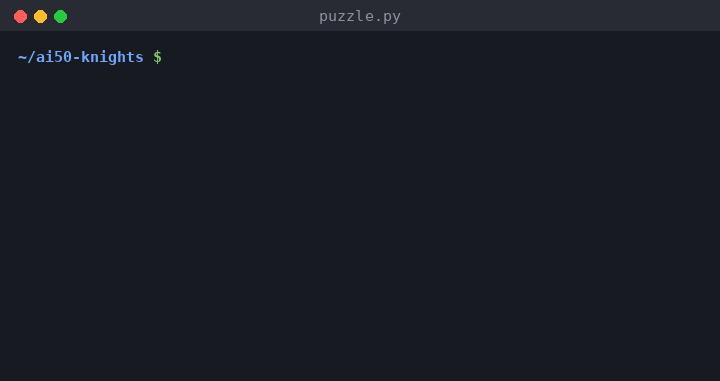

# Knights and Knaves Solver

A program that solves "Knights and Knaves" logic puzzles with propositional logic. Each puzzle is written as a knowledge base of logical sentences, and a model-checking algorithm works out which characters must be knights (who always tell the truth) and which must be knaves (who always lie). This is the Knights project from Harvard's CS50 Introduction to Artificial Intelligence with Python.



## What it does

`puzzle.py` solves four puzzles and prints every fact the knowledge base proves:

| Puzzle | What the characters say | Solution |
| --- | --- | --- |
| 0 | A says "I am both a knight and a knave." | A is a knave |
| 1 | A says "We are both knaves." B says nothing. | A is a knave, B is a knight |
| 2 | A says "We are the same kind." B says "We are of different kinds." | A is a knave, B is a knight |
| 3 | A says either "I am a knight." or "I am a knave.", but you don't know which. B says "A said 'I am a knave'." B says "C is a knave." C says "A is a knight." | A is a knight, B is a knave, C is a knight |

## How it works

### Symbols

Each character gets two propositional symbols, for example `AKnight` ("A is a Knight") and `AKnave` ("A is a Knave"). Six symbols cover characters A, B and C.

### Knowledge bases

Each puzzle is one `And(...)` of sentences built from the classes in `logic.py` (`Not`, `And`, `Or`, `Biconditional`). Two kinds of sentence are enough:

1. **The rules of the game.** Every character is a knight or a knave, but not both: `Biconditional(AKnight, Not(AKnave))`.
2. **What each character says.** A knight's statement is true and a knave's is false, so "A is a knight" holds exactly when A's statement holds. A statement S from A becomes `Biconditional(AKnight, S)`.

For example, Puzzle 2 is encoded as:

```python
knowledge2 = And(
    Biconditional(AKnight, Not(AKnave)),
    Biconditional(BKnight, Not(BKnave)),

    # A: "We are the same kind."
    Biconditional(AKnight, Or(And(AKnight, BKnight), And(AKnave, BKnave))),
    # B: "We are of different kinds."
    Biconditional(BKnight, Or(And(AKnight, BKnave), And(BKnight, AKnave)))
)
```

### Model checking

`model_check(knowledge, query)` in `logic.py` decides whether the knowledge base entails a query:

1. It collects every symbol that appears in the knowledge base and the query.
2. It recursively builds every possible model, assigning each symbol true and then false (2ⁿ models for n symbols).
3. In each complete model where the knowledge base is true, the query must also be true. If that holds in every such model, the knowledge base entails the query.

`main()` asks this question for each of the six symbols and prints the ones that are entailed. Those printed facts are the puzzle's solution.

## What I implemented

The course provides `logic.py` (the sentence classes and `model_check`) and the skeleton of `puzzle.py` (the symbols and `main()`). I wrote the four knowledge bases, `knowledge0` to `knowledge3`, that turn each puzzle into propositional logic.

## Project structure

```
puzzle.py   The four puzzles as knowledge bases, and main(), which prints the solutions
logic.py    Propositional logic classes (Symbol, Not, And, Or, Implication, Biconditional) and model_check
```

## Running it locally

The program uses only the Python standard library, so there is nothing to install. It was tested with Python 3.13.

```bash
git clone https://github.com/sangyetenphel/ai50-knights.git
cd ai50-knights
python3 puzzle.py
```

## Built with

- Python 3 (standard library only)

## Credits

This is a project from [CS50's Introduction to Artificial Intelligence with Python](https://cs50.harvard.edu/ai/) by Harvard University. The project specification, `logic.py` and the starter code come from the course.

Created by Sangye Tenphel, 2020.
